<div align="center">

<table>
<tr>
<td valign="top"></td>
<td valign="top"></td>
</tr>
</table>

# Khoi Do — Portfolio

**Human-centered AI, real-time systems, and web experiences built with product discipline.**

An interactive portfolio that turns my projects, experience, and engineering practice into one focused digital experience.

<p>
  <a href="https://www.khoido.com/"></a>
  <a href="https://github.com/Ben2104"></a>
  <a href="https://www.linkedin.com/in/hoang-khoi-do/"></a>
</p>

</div>

## Site structure

The homepage presents my background, education, work experience, and projects. The project archive links to ten case studies with screenshots, technical details, and project links. The experience timeline uses a Three.js scene with a list view for visitors who prefer reduced motion.

## Stack

| Layer | Technology |
| --- | --- |
| Framework | Next.js 16, React 19, TypeScript |
| Styling | Tailwind CSS 4, custom CSS tokens |
| Motion and 3D | Motion, Three.js |
| Analytics and delivery | Vercel Analytics, Vercel |

## Run locally

CI uses Node.js 22 and npm.

```bash
git clone https://github.com/Ben2104/portfolio.git
cd portfolio
npm ci
npm run dev
```

Open [http://localhost:3000](http://localhost:3000).

### Local checks

```bash
npm run lint
npx next typegen
npx tsc --noEmit
npm run build
npm run start
```

With Google Chrome installed and the production server running, run `node scripts/verify-site.mjs --url http://localhost:3000` for desktop and mobile browser checks.

## Project map

```text
src/app/                 Homepage, layout, and project case-study route
src/components/deck/     Site sections, navigation, and experience scene
src/data/site.ts          Portfolio content and project links
src/styles/               Styles for the homepage and case studies
public/deck/              Site photography, project artwork, and icons
```

## Contact

Building something useful, technically ambitious, or human-centered?

- [LinkedIn](https://www.linkedin.com/in/hoang-khoi-do/)
- [GitHub](https://github.com/Ben2104)
- [Email](mailto:dohoangkhoi341@gmail.com)

<div align="center">

Built by [Khoi Do](https://www.khoido.com/). ASCII profile art generated with [ascii-profile-kit](https://github.com/mithun50/ascii-profile-kit).

</div>
